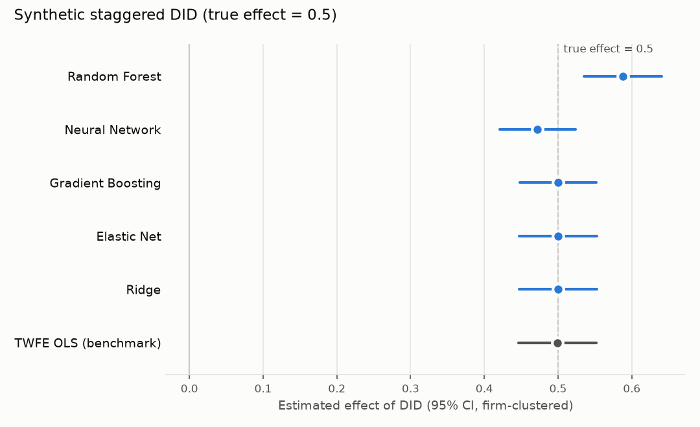
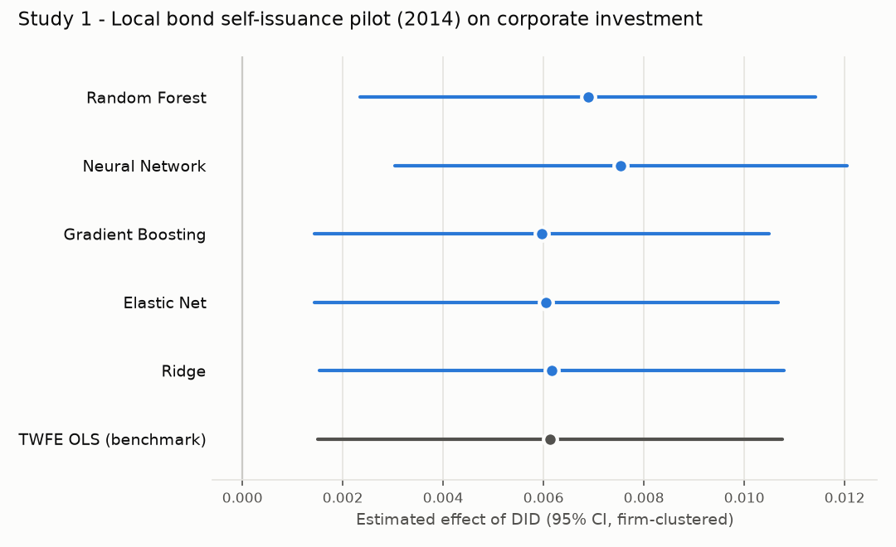
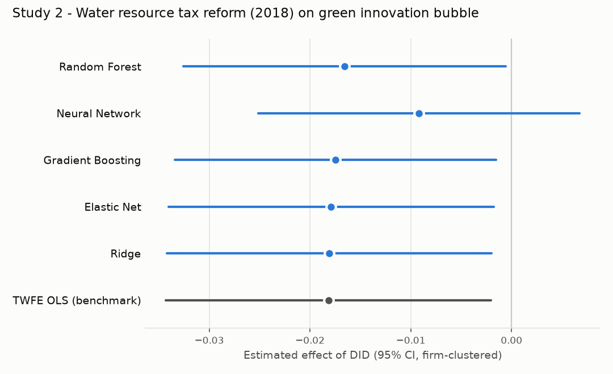
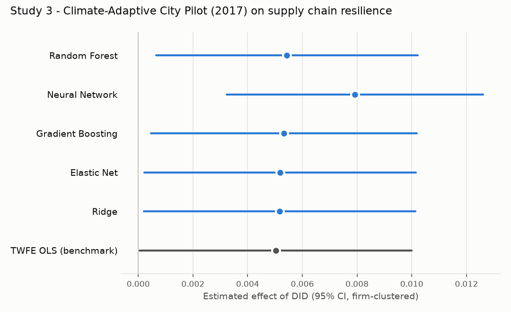
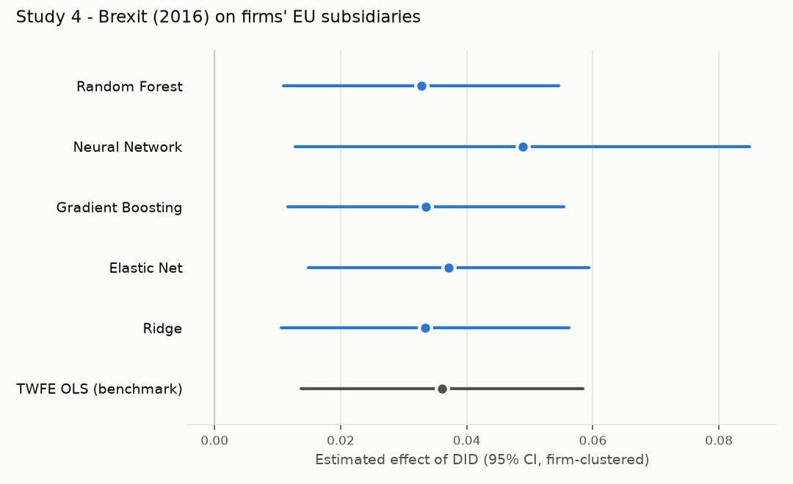

# Double Machine Learning for Difference-in-Differences on Firm Panels

A config-driven Python pipeline that estimates difference-in-differences (DID)
policy effects with **double/debiased machine learning (DML)** on firm-year panel
data with two-way fixed effects. For each study it fits five nuisance learners
(random forest, neural network, gradient boosting, elastic net, ridge) and
reports them next to a conventional two-way fixed-effects (TWFE) OLS benchmark,
so you can check whether a result depends on how the controls are modelled.

It is applied to four policy evaluations, each with 21k–48k firm-years:

| # | Policy (quasi-natural experiment) | Outcome | Firms |
|---|---|---|---|
| 1 | Local government bond **"self-issuance and self-repayment" pilot** (2014) | Corporate investment | Chinese A-share |
| 2 | **Water resource tax reform** (extension effective Dec 2017) | Green innovation bubble | Chinese A-share |
| 3 | **Climate-Adaptive City Pilot** (2017) | Supply chain resilience | Chinese A-share manufacturing |
| 4 | **Brexit** referendum (2016) | EU subsidiaries outside the home country | UK vs. EU27 firms (Orbis) |

The Study 3 estimation sample is included (trimmed and anonymised; see
[`data/README.md`](data/README.md)), so the results can be reproduced exactly
from a fresh clone. A synthetic dataset with a known effect is included as well.

<p align="center"></p>

---

## Method

### Model

The partially linear panel regression (PLPR) of Clarke & Polselli (2025):

$$
Y_{it} = \theta_0 \, D_{it} + g_0(X_{it}) + \alpha_i + \varepsilon_{it}, \qquad
D_{it} = m_0(X_{it}) + \gamma_i + v_{it}
$$

* $D_{it} = \text{Treat}_i \times \text{Post}_t$ is the DID indicator, and $\theta_0$ is the policy effect.
* $X_{it}$ holds firm-level controls **plus year dummies**, so year effects are part of $g_0$ and $m_0$.
* $\alpha_i, \gamma_i$ are firm fixed effects that may be correlated with $X_{it}$ and $D_{it}$.
* $g_0$ and $m_0$ are left unrestricted and learned by ML, instead of being assumed linear as in TWFE OLS.

### Estimation

1. **Within-group transformation** (`approach: wg_approx`). Demean $Y$, $D$ and $X$ within each firm to sweep out $\alpha_i$. Together with the year dummies in $X$, this gives a two-way fixed-effects design.
2. **Cross-fitting.** Split the *firms* into $K=5$ folds, so all observations of a firm sit in the same fold. On each fold, fit $\hat\ell(X) \approx E[\tilde Y \mid \tilde X]$ and $\hat m(X) \approx E[\tilde D \mid \tilde X]$ on the other folds and predict out-of-fold.
3. **Neyman-orthogonal "partialling-out" score.** Regress the outcome residual on the treatment residual:

$$
\hat\theta = \frac{\sum_{i,t} \big(\tilde D_{it} - \hat m(\tilde X_{it})\big)\big(\tilde Y_{it} - \hat\ell(\tilde X_{it})\big)}{\sum_{i,t} \big(\tilde D_{it} - \hat m(\tilde X_{it})\big)^2}
$$

   Because the score is orthogonal, first-order errors in $\hat\ell$ and $\hat m$ do not bias $\hat\theta$. Combined with cross-fitting, this gives $\sqrt{N}$-consistent, asymptotically normal estimates even with flexible, regularised learners (Chernozhukov et al., 2018).
4. **Inference.** Standard errors are **clustered by firm**, and 95% CIs are reported.

### Learners

| Learner | Specification |
|---|---|
| Random Forest | 500 trees, `max_depth=8`, `min_samples_leaf=5` |
| Neural Network | MLP (64, 32), standardised inputs, early stopping |
| Gradient Boosting | `HistGradientBoosting`, lr 0.05, 300 iterations, 15 leaves, L2 = 1 |
| Elastic Net | `ElasticNetCV`, `l1_ratio` in {0.1, 0.5, 0.7, 0.9, 1}, 5-fold CV |
| Ridge | `RidgeCV`, alpha in {0.01, 0.1, 1, 10, 100} |
| *TWFE OLS* | *benchmark: firm-demeaned OLS with year dummies and firm-clustered SE, analogous to Stata `xtreg, fe vce(cluster id)`* |

The same learner is used for both nuisance functions. All runs are seeded, and with the library versions pinned in `requirements.txt` the results reproduce exactly. The neural network and gradient boosting can move slightly under other versions. This pipeline replaces four earlier per-study scripts and returns identical coefficients and standard errors for every learner.

---

## Repository structure

```
dml-did-panel/
├── run_dml.py                 # CLI: run one or more studies from YAML configs
├── make_synthetic_data.py     # writes data/synthetic_did.csv (known effect = 0.5)
├── configs/                   # one YAML file per study
│   ├── demo_synthetic.yaml
│   ├── study1_bond_pilot.yaml
│   ├── study2_water_tax.yaml
│   ├── study3_climate_pilot.yaml
│   └── study4_brexit.yaml
├── dml_did/
│   ├── config.py              # StudyConfig dataclass + YAML loader
│   ├── data.py                # load .dta/.csv/.parquet, clean, validate, year dummies
│   ├── learners.py            # the five nuisance learners
│   ├── estimate.py            # DoubleMLPLPR per learner + TWFE OLS benchmark
│   ├── report.py              # CSV / Markdown tables and coefficient plots
│   └── synthetic.py           # staggered-adoption DGP with known effect
├── tests/test_pipeline.py     # data checks + effect recovery on synthetic data
├── results/                   # estimates (.csv, .md) and plots (.png) per study
└── data/                      # Study 3 panel (included); other raw files are git-ignored
```

---

## Quick start

```bash
python -m venv .venv            # Python 3.12
.venv\Scripts\activate          # Windows  (macOS/Linux: source .venv/bin/activate)
pip install -r requirements.txt

# 1. Real data, included: reproduces the Study 3 results below exactly
python run_dml.py configs/study3_climate_pilot.yaml

# 2. Synthetic data with a known effect (true theta = 0.5)
python make_synthetic_data.py
python run_dml.py configs/demo_synthetic.yaml

# 3. Studies 1, 2 and 4 (licensed raw files must be placed in data/ first)
python run_dml.py "configs/study*.yaml"

# Options: choose learners, repeat the cross-fitting split 5 times
python run_dml.py configs/study3_climate_pilot.yaml --learners ridge gradient_boosting --n-rep 5

# Tests
pytest
```

Each run writes `results/<name>.csv`, `results/<name>.md` and `results/<name>.png`.

### Using your own data

Copy a config and edit the column names. Nothing else needs to change.

```yaml
name: my_study
description: "My policy - effect on outcome Y"
data_path: data/my_panel.dta    # .dta, .csv or .parquet
y_col: Y                        # outcome
d_col: did                      # Treat x Post (0/1)
id_col: firm_id                 # firm identifier (string ids are mapped to integers)
time_col: year
controls: [Size, Lev, ROA]
# optional (defaults shown)
learners: [random_forest, neural_network, gradient_boosting, elastic_net, ridge]
approach: wg_approx             # or fd_exact, cre_general, cre_normal
n_folds: 5
n_rep: 1
seed: 123
twfe_benchmark: true
```

The loader checks that `(id, year)` is unique and that the treatment is a 0/1 indicator. It drops rows with missing or infinite values.

---

## Results

### Synthetic data (true effect = 0.5)

2,000 firms × 12 years with staggered adoption. Treated firms follow a different trend in `x1`, so parallel trends hold only conditional on the covariates, and the outcome depends on them non-linearly.

| Method | Coef. | Std. err. | 95% CI |
|---|---:|---:|---|
| DML - Random Forest | 0.588 | 0.027 | [0.535, 0.641] |
| DML - Neural Network | 0.472 | 0.026 | [0.421, 0.524] |
| DML - Gradient Boosting | 0.500 | 0.027 | [0.448, 0.552] |
| DML - Elastic Net | 0.500 | 0.027 | [0.447, 0.553] |
| DML - Ridge | 0.500 | 0.027 | [0.447, 0.553] |
| TWFE OLS (benchmark) | 0.499 | 0.027 | [0.446, 0.552] |

Gradient boosting, elastic net, ridge and TWFE all land within 0.001 of the truth. The neural network is close. The random forest is biased upward: a depth-limited forest approximates the *linear* part of $g_0$ with coarse steps, and the leftover error is correlated with treatment. This is why the pipeline reports several learners instead of trusting one.

### Empirical studies

Each study regresses a firm outcome on a policy DID indicator $D_{it} = \text{Treat}_i \times \text{Post}_t$, with firm and year fixed effects and firm-clustered standard errors.

**Study 1: Local government bond "self-issuance and self-repayment" pilot (地方政府债券"自发自还"试点).**
In May 2014 the State Council let 10 regions issue, service and repay their own government bonds within an approved quota: Shanghai, Zhejiang, Guangdong, Shenzhen, Jiangsu, Shandong, Beijing, Jiangxi, Ningxia and Qingdao. Before this, the Ministry of Finance repaid local government bonds on the regions' behalf, and outside a few earlier issuance pilots it also issued them. *Treat* = firm located in a pilot province (Shenzhen and Qingdao are counted under Guangdong and Shandong). *Post* = 2014 onward. Outcome: corporate investment level.

**Study 2: Water resource tax reform (水资源税改革).**
Hebei replaced its water resource fee with a water resource tax from July 2016. From 1 December 2017 the reform was extended to Beijing, Tianjin, Shanxi, Inner Mongolia, Shandong, Henan, Sichuan, Shaanxi and Ningxia (Caishui [2017] No. 80). *Treat* = firm located in one of these 10 provinces. *Post* = 2018 onward, i.e. the policy is lagged to the first full year after the extension. Outcome: corporate green innovation bubble.

**Study 3: Climate-Adaptive City Pilot (气候适应型城市建设试点).**
In February 2017 the NDRC and the Ministry of Housing and Urban-Rural Development named 28 pilot areas (Fagai Qihou [2017] No. 343) to strengthen climate-risk monitoring, adaptive infrastructure and public participation. *Treat* = manufacturing firm located in a pilot city. *Post* = 2017 onward. Outcome: an entropy-method supply chain resilience index.

**Study 4: Brexit.**
On 23 June 2016 the UK voted to leave the EU. It formally left on 31 January 2020, and the transition period ended on 31 December 2020. *Treat* = UK-headquartered firm. The control group is firms headquartered in the EU27. *Post* = 2016 onward. Outcome: ln(1 + number of the firm's EU subsidiaries outside its home country). This measures how far a group spreads its legal presence across the EU single market.

In all four studies treatment starts in one year for the whole treated group (a single cohort, not staggered adoption). Firms that enter the panel later (e.g. after listing) or move into a treated region are first observed as treated in a later year.

| | Study 1 | Study 2 | Study 3 | Study 4 |
|---|---|---|---|---|
| Policy | Bond self-issuance pilot | Water resource tax | Climate-Adaptive City Pilot | Brexit |
| Policy year (*Post* = 1 from) | 2014 | 2018 | 2017 | 2016 |
| Outcome | Investment (`Invest3`) | Green innovation bubble (`CGI_bub`) | Supply chain resilience (`SCR`) | EU subsidiaries (`EU`) |
| Treated vs. control | Pilot vs. other provinces | Reform vs. other provinces | Pilot vs. other cities | UK vs. EU27 firms |
| Sample | Chinese A-share firms | Chinese A-share firms | Chinese A-share manufacturing firms | European firms (Orbis) |
| Firm-years | 33,867 | 47,703 | 21,157 | 46,121 |
| Firms | 4,144 | 5,383 | 2,921 | 4,939 |
| Years | 2010–2023 | 2009–2024 | 2011–2023 | 2011–2024 |
| Ever-treated firms | 65.5% | 25.8% | 8.6% | 18.6% |
| Firm-years with *D* = 1 | 50.7% | 15.2% | 5.6% | 14.0% |

**Estimated DID effect: coefficient (firm-clustered standard error)**

| Method | Study 1 | Study 2 | Study 3 | Study 4 |
|---|---:|---:|---:|---:|
| DML - Random Forest | 0.0069*** (0.0023) | −0.0166** (0.0082) | 0.0054** (0.0024) | 0.0328*** (0.0111) |
| DML - Neural Network | 0.0075*** (0.0023) | −0.0092 (0.0081) | 0.0079*** (0.0024) | 0.0488*** (0.0184) |
| DML - Gradient Boosting | 0.0060*** (0.0023) | −0.0175** (0.0081) | 0.0053** (0.0025) | 0.0335*** (0.0112) |
| DML - Elastic Net | 0.0061** (0.0024) | −0.0179** (0.0082) | 0.0052** (0.0025) | 0.0371*** (0.0114) |
| DML - Ridge | 0.0062*** (0.0024) | −0.0181** (0.0082) | 0.0052** (0.0025) | 0.0334*** (0.0116) |
| TWFE OLS (benchmark) | 0.0061*** (0.0024) | −0.0182** (0.0082) | 0.0050** (0.0025) | 0.0361*** (0.0114) |

*** p<0.01, ** p<0.05, * p<0.1. Full tables with p-values and CIs: [`results/`](results/).

**Takeaways**

* In all four studies the sign of the effect is the same for every nuisance learner, and four of the five learners stay close to the linear TWFE benchmark. The findings do not hinge on a linear specification of the controls:
  * the bond pilot raises corporate investment;
  * the water resource tax reduces the green innovation bubble;
  * the climate-adaptive city pilot strengthens supply chain resilience;
  * after the referendum, UK firms expand their EU subsidiary networks relative to EU27 firms.
* The neural network is the least stable learner. In Study 2 it is the only estimate that is not significant, and in Study 4 it gives the largest point estimate with a much wider standard error, so it is best read as a robustness check rather than the headline.

<p align="center">
  
  
  
  
</p>

---

## Notes and limitations

* **`wg_approx` is an approximation.** Demeaning a non-linear $g_0(X_{it})$ is not the same as $g_0$ of the demeaned $X$. Clarke & Polselli (2025) show that this works well in many settings, but `fd_exact` (first differences) and the correlated-random-effects variants `cre_general` / `cre_normal` are one config line away and make a useful robustness check.
* **Homogeneous, static effect.** Like TWFE, the PLPR estimate is a single average effect over all post-treatment years. All four policies have a single treatment date, so the negative-weighting problem of TWFE under staggered adoption (Goodman-Bacon, 2021; de Chaisemartin & D'Haultfœuille, 2020) does not arise. Effects may still build up or fade over time. Event-study or group-time estimators (e.g. Callaway & Sant'Anna, 2021, available in `DoubleML` as `DoubleMLDIDMulti`) are the natural extension to show those dynamics.
* **Identification still rests on (conditional) parallel trends.** DML makes the adjustment for controls flexible. It does not replace pre-trend checks or placebo tests.

---

## References

* Chernozhukov, V., Chetverikov, D., Demirer, M., Duflo, E., Hansen, C., Newey, W., & Robins, J. (2018). Double/debiased machine learning for treatment and structural parameters. *The Econometrics Journal*, 21(1), C1–C68.
* Clarke, P. S., & Polselli, A. (2025). Double machine learning for static panel models with fixed effects. *The Econometrics Journal*, utaf011. https://doi.org/10.1093/ectj/utaf011
* Bach, P., Chernozhukov, V., Kurz, M. S., & Spindler, M. (2022). DoubleML – An object-oriented implementation of double machine learning in Python. *Journal of Machine Learning Research*, 23(53), 1–6.
* Goodman-Bacon, A. (2021). Difference-in-differences with variation in treatment timing. *Journal of Econometrics*, 225(2), 254–277.
* de Chaisemartin, C., & D'Haultfœuille, X. (2020). Two-way fixed effects estimators with heterogeneous treatment effects. *American Economic Review*, 110(9), 2964–2996.
* Callaway, B., & Sant'Anna, P. H. C. (2021). Difference-in-differences with multiple time periods. *Journal of Econometrics*, 225(2), 200–230.

**Policy documents**

* Ministry of Finance (2014). [2014年地方政府债券自发自还试点办法](http://m.mof.gov.cn/zcfb/201405/t20140521_1082114.htm) (Measures for the 2014 pilot of local government bond self-issuance and self-repayment).
* Ministry of Finance, State Taxation Administration & Ministry of Water Resources (2017). [扩大水资源税改革试点实施办法](https://www.gov.cn/gongbao/content/2018/content_5280598.htm), Caishui [2017] No. 80.
* NDRC & MOHURD (2017). [关于印发气候适应型城市建设试点工作的通知](https://www.ndrc.gov.cn/xxgk/zcfb/tz/201702/t20170224_962916.html), Fagai Qihou [2017] No. 343.
* House of Commons Library. [Brexit timeline: events leading to the UK's exit from the European Union](https://commonslibrary.parliament.uk/research-briefings/cbp-7960/).

---

**Author:** reviver. Built with [DoubleML](https://docs.doubleml.org/) and scikit-learn.
